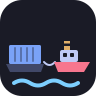

# hikifune

**Checks images and updates containers across Docker hosts, with one agent per host**

> [!NOTE]
> This is a draft. Nothing is built yet. [The plan](docs/PLAN.md) has the design decisions so far and the open questions.

## What it will do

- Runs a small agent on each Docker host and one server that holds the schedule, the web UI and the notifications.
- Checks every container's image for a newer digest once a day and updates the ones that have one. The defaults are 00:00 for checks and 01:00 for updates.
- Updates everything unless told not to. A container with no `hikifune.*` label is checked and updated, and `hikifune.protected=true` keeps it from being updated automatically. The web UI lists every container either way.
- Recreates a container from the configuration the Docker Engine reports for it, changing only the image, so health checks, GPU requests and networks come back as they were.
- Keeps the old container under another name until the new one is up. A scheduled update that fails is rolled back to it, and that image digest is skipped at the next run.
- After each check and each update run, sends one Discord message per host listing what is available, updated, rolled back and failed, with the reason for each rollback and failure. The message template can be edited.
- Works with Docker 24 (Engine API 1.43) and newer.

## Name

Hikifune (曳船) is Japanese for a tugboat. The agent tows each container back into its place.

## License

[MIT](LICENSE)
